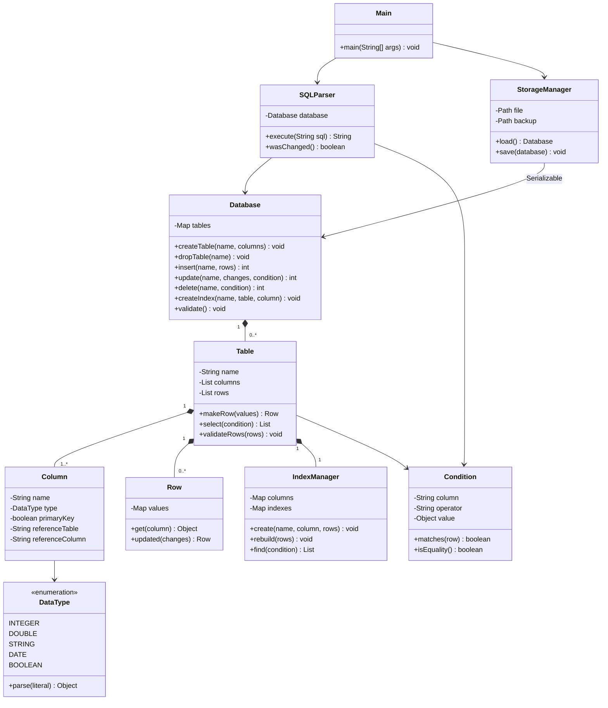
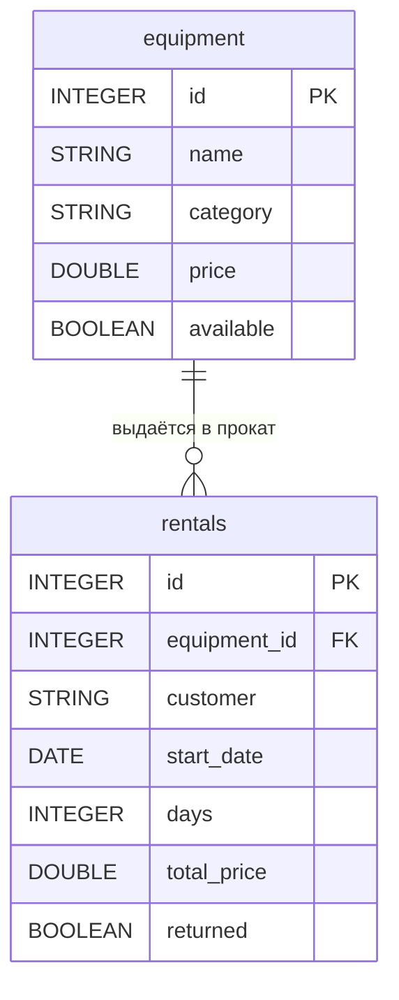

# Диаграмма классов

`Database` выполняет роль Repository, `StorageManager` — роль DAO файлового
хранилища. Отдельные интерфейсы для единственной реализации не вводятся.
Строки перебираются через стандартные коллекции Java и их Iterator (`for-each`).

## Связь демонстрационных таблиц

Структура задаётся SQL-командами, а не зашита в Java. `equipment_id` ссылается
на `equipment.id`. Любой внешний ключ может быть NULL; если значение задано,
родительская запись обязана существовать. Первичный ключ всегда непустой.
