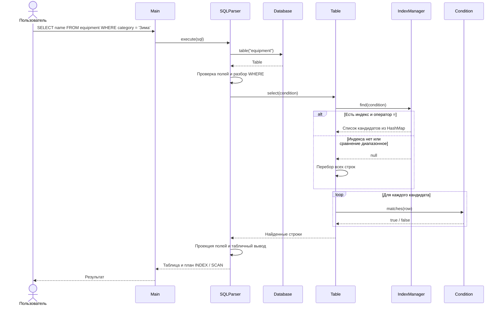
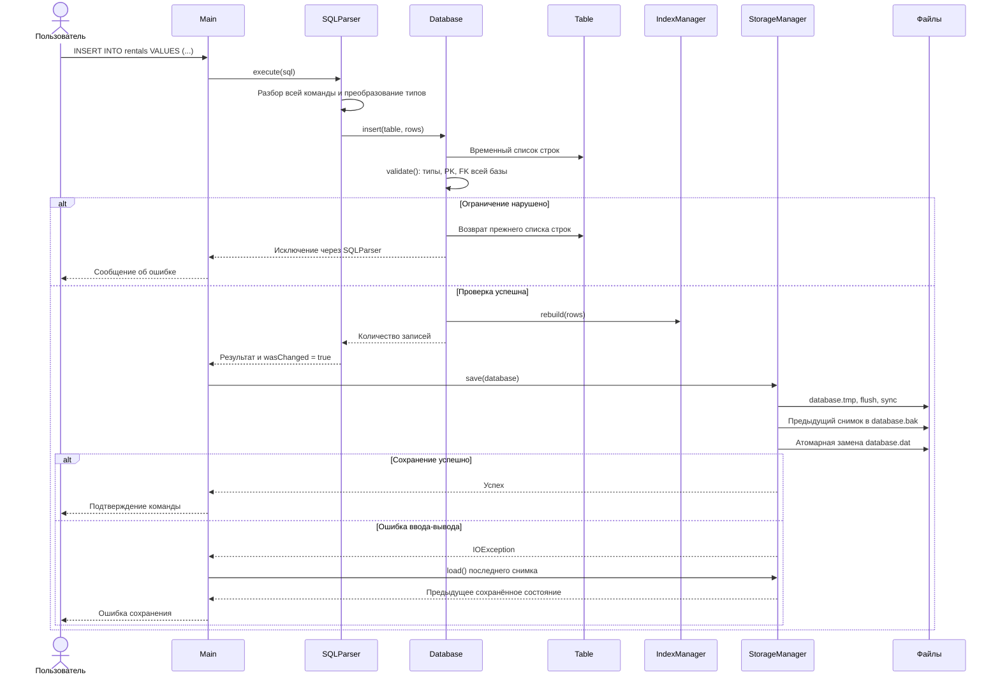

# Диаграммы последовательностей

## SELECT по индексированному полю

## Изменение и сохранение

При старте `Main` вызывает `StorageManager.load()`. Снимок содержит таблицы,
строки, описание индексов и хеш-структуры со ссылками на те же строки.
Отдельного построения индексов при загрузке не требуется. Повреждённый основной
снимок заменяется пригодной резервной копией с предупреждением в консоли.
